# Threads 帳號貼文爬取與數據分析

輸入一個 Threads 帳號名稱或帳號網址，用 Playwright 抓最近 30 篇主貼文（含曝光數），清理後產出互動表現分析報告：總覽指標、互動率 Top 5、發文時間分布、文字長度與互動、貼文類型、關鍵字與 hashtag、三群分群的 NLP 成功／失敗分析，以及 3 點內容策略觀察。

- 線上版：https://threads-analyzer-flax.vercel.app （需註冊登入；爬取由另外常駐的 worker 處理，見「部署到 Vercel」）
- 網頁：Next.js（App Router）＋ Supabase Auth（Email／Password），部署在 Vercel
- 資料：Supabase Postgres，所有表開 RLS，使用者只看得到自己的資料
- 爬蟲：Playwright worker，獨立執行（本機或 Docker）
- 命令列：不經網站也能直接出 Markdown 報告（`reports/`）
- 任務管理：建立、查看、重跑（略過快取重新爬取）、刪除；同一帳號分析中不重複建立
- LLM 建議：worker 設定 `ANTHROPIC_API_KEY` 時，用 Claude 依統計結果產生 3–5 條內容策略建議
- 產品規格：[docs/PRD.md](docs/PRD.md)（功能、流程、資料權限、例外情境、Given／When／Then 驗收標準、任務拆解）

## 畫面截圖

2026-11-11 在線上版（Vercel）實際操作的截圖，資料都是用 Playwright 真實爬到的（非假資料）。登入 email 已遮蔽。

**登入與任務管理**

| 登入頁（未登入一律導到這裡） | 任務列表：一筆爬取中、其餘完成 |
|---|---|
| 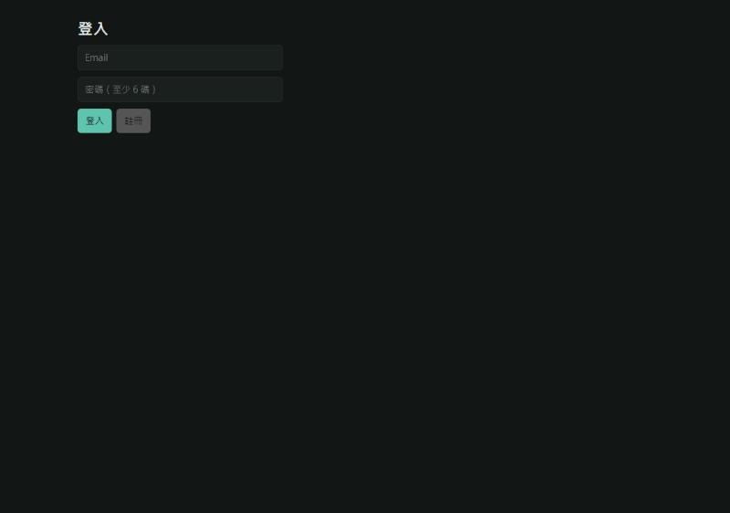 | 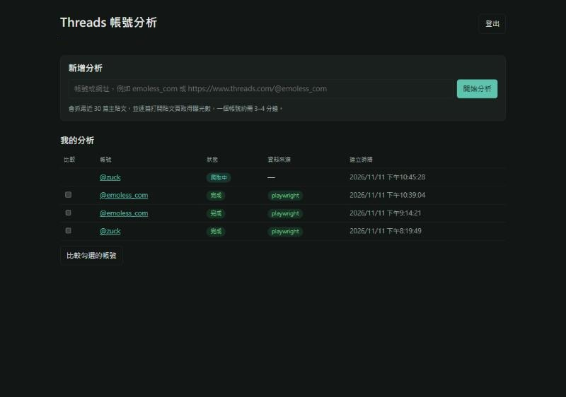 |

| 重跑：略過快取重新爬取 | 同一帳號分析中時不重複建立 | 刪除：任務、貼文、結果一併刪除 |
|---|---|---|
| 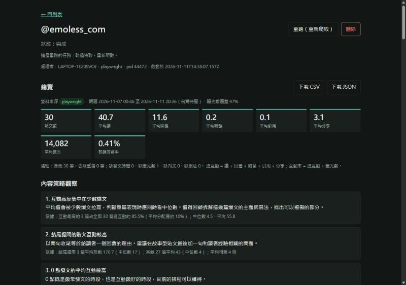 | 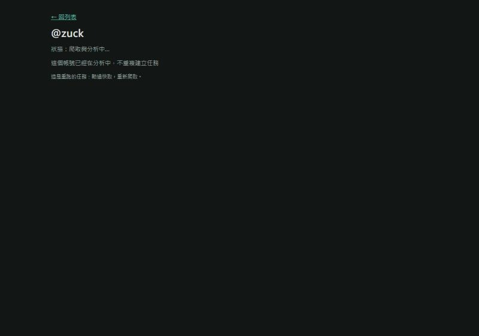 | 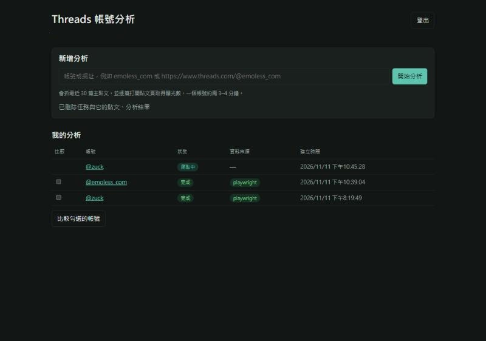 |

**報告各區（@emoless_com）**

| 內容策略觀察、LLM 建議區、Top 5 | 發文時間分布、字數 × 互動、貼文類型 |
|---|---|
| 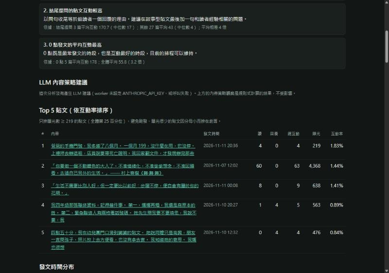 | 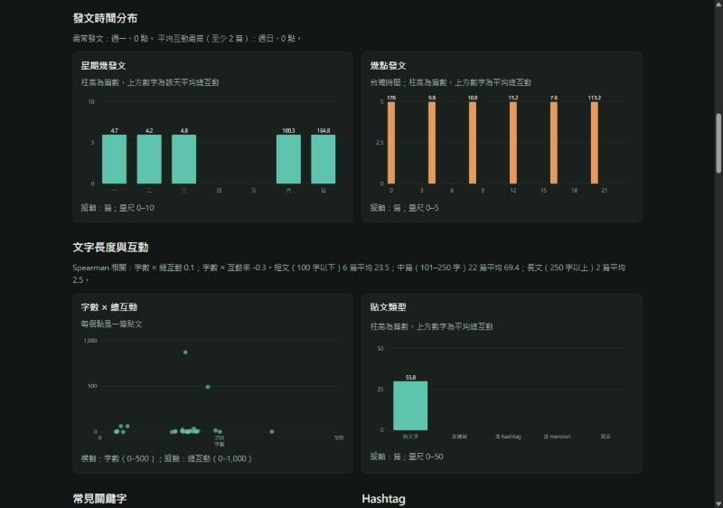 |

| 關鍵字、hashtag、分群與 NLP 原因 | 全部貼文（清理後） |
|---|---|
| 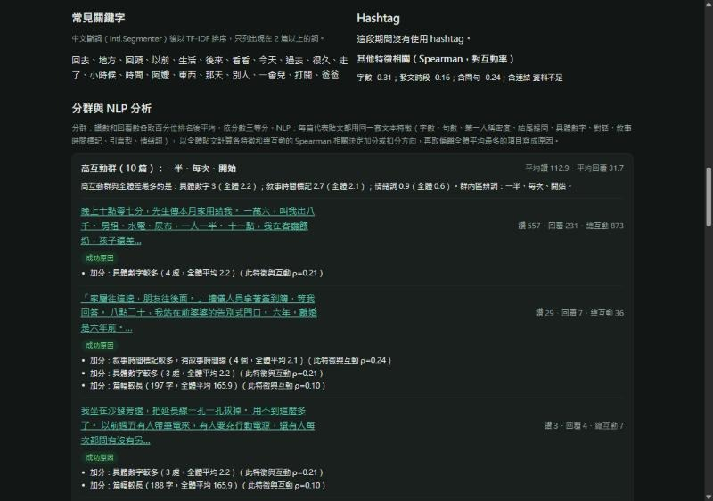 | 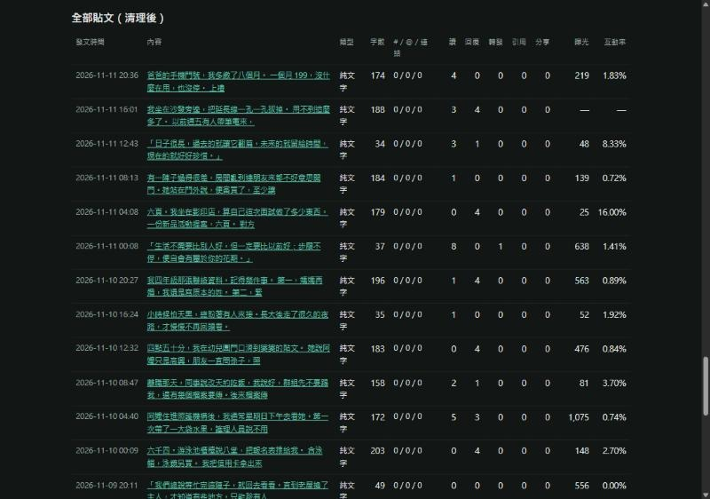 |

**多帳號比較**與第二個帳號（@zuck）

| 多帳號比較 | @zuck 報告 |
|---|---|
| 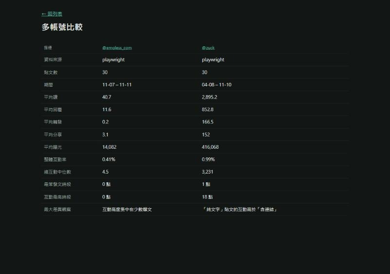 | 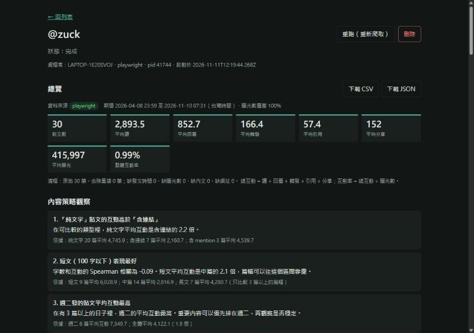 |

**資料真實性比對**：打開 Threads 原頁，和爬蟲讀到的數字逐欄比對。

| 貼文 | 來源 | 讚 | 回覆 | 轉發 | 分享 | 瀏覽 |
|---|---|---:|---:|---:|---:|---:|
| DfmAPYlG4ib | Threads 原頁 | 3 | 4 | — | — | 44 |
| | 爬蟲讀到 | 3 | 4 | 0 | 0 | 44 |
| Dd2BfosAcIX | Threads 原頁 | 736 | 9 | 4 | 98 | 11 萬 |
| | 爬蟲讀到 | 736 | 9 | 4 | 98 | 110,638 |

| Threads 原頁：DfmAPYlG4ib | Threads 原頁：Dd2BfosAcIX |
|---|---|
|  | 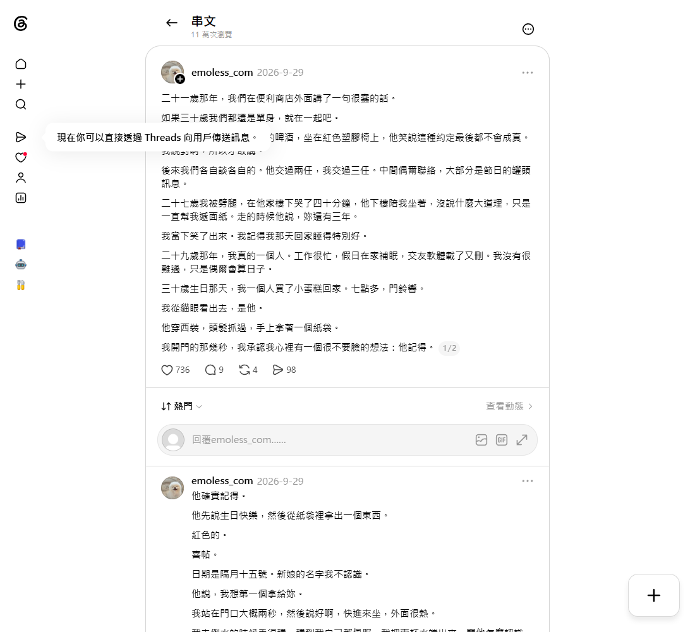 |

## 目錄

```
.
├── web/                      Next.js 網站（Vercel 的 Root Directory）
│   └── src/app/              登入、任務列表、報告頁、多帳號比較、CSV／JSON 匯出 API
├── worker/                   Playwright worker
│   └── src/
│       ├── scrape/           爬取（playwright.ts）、JSON 解析（extract.ts）、假資料（mock.ts）
│       ├── index.ts          輪詢任務 → 快取 → 爬取 → 清理分析 → 寫回
│       ├── report-cli.ts     命令列產生 data/ 與 reports/
│       ├── login.ts          副帳號登入，存登入狀態
│       └── probe.ts          爬取可行性實測（存下所有回應）
├── shared/src/               兩邊共用：清理（clean.ts）、分析（analysis.ts）、NLP（nlp.ts）、型別
├── supabase/migrations/      資料表、RLS、函式
├── data/                     實際爬到的原始資料（JSON）
├── reports/                  命令列產出的分析報告（Markdown＋JSON）
├── docs/screenshots/         實際操作截圖
├── AI_LOG.md                 AI 協作紀錄
├── docker-compose.yml        一鍵啟動 worker
└── .env.example              所有環境變數
```

題目要求的 `src/`：本專案是 monorepo，程式碼分別在 `web/src/`、`worker/src/`、`shared/src/`。

## 安裝

需要 Node.js 20 以上。

```bash
npm install
cp .env.example .env              # worker 用
cp .env.example web/.env.local    # 網站用（只需要 NEXT_PUBLIC_ 開頭的兩個）
```

1. 建一個 Supabase 專案，依序在 SQL Editor 執行 `supabase/migrations/` 下的 0001 到 0004。
2. 從 Project Settings → API 填入 URL、anon key（網站）與 service_role key（worker）。
3. 安裝爬蟲用的瀏覽器：`npx playwright install chromium`。Windows 上若安裝卡住，在 `.env` 設 `BROWSER_CHANNEL=msedge` 改用系統內建的 Edge。
4. （建議）用副帳號登入 Threads：`npm run login -w worker`，在跳出的視窗登入並完成「加入 Threads」，登入狀態會存到 `worker/.auth/threads.json`。沒有登入只能拿到約 28 篇。

## 執行

| 做什麼 | 指令 |
|---|---|
| 網站（http://localhost:3000） | `npm run dev:web` |
| worker（真實爬取） | `npm run dev:worker` |
| worker（Docker 一鍵啟動） | `docker compose up --build` |
| 不經網站直接出報告 | `npm run report -w worker -- emoless_com` |
| 用已存的資料重出報告 | `npm run report -w worker -- emoless_com --from data/emoless_com_2026-11-11.json` |
| 把網站 worker 爬到的資料存成檔案 | `cd worker && npx tsx --env-file=../.env src/export-cache.ts emoless_com`（讀 Supabase 的 scrape_cache，寫到 `data/`） |
| 檢查 Supabase 設定 | `npm run check -w worker` |
| 爬取可行性實測 | `npm run probe -w worker -- emoless_com` |
| 單元測試 | `npm test` |
| 型別檢查 | `npm run typecheck` |

網站流程：註冊或登入 → 輸入帳號（`emoless_com`、`@emoless_com` 或 `https://www.threads.com/@emoless_com` 都可以）→ 狀態自動從「排隊中」變「爬取中」再變「完成」→ 看報告、下載 CSV／JSON。列表勾選兩個以上已完成的分析可以並排比較。

## 部署到 Vercel

1. 在 Vercel 匯入這個 repo，**Root Directory 設為 `web`**，Framework 會自動偵測為 Next.js（`web/vercel.json` 也有指定）。
2. Environment Variables 填 `NEXT_PUBLIC_SUPABASE_URL` 與 `NEXT_PUBLIC_SUPABASE_ANON_KEY`。service_role key **不要**放到 Vercel。
3. 部署完成後，到 Supabase → Authentication → URL Configuration，把 Vercel 網址加到 Site URL 與 Redirect URLs，註冊確認信才會連回正確網址。
4. worker 不跑在 Vercel：serverless 有執行時間上限（爬一個帳號約 3–4 分鐘），也不適合裝瀏覽器。worker 放在本機或任何能跑 Docker 的主機，用 `docker compose up -d` 常駐；線上網站建立的任務會由它處理。

## 環境變數

完整說明見 `.env.example`。

| 變數 | 用在 | 說明 |
|---|---|---|
| `NEXT_PUBLIC_SUPABASE_URL` | 網站 | Supabase 專案網址 |
| `NEXT_PUBLIC_SUPABASE_ANON_KEY` | 網站 | 可公開的 anon key，受 RLS 限制 |
| `SUPABASE_URL` | worker | 同上 |
| `SUPABASE_SERVICE_ROLE_KEY` | worker | 繞過 RLS，只放 worker |
| `DATA_SOURCE` | worker | `playwright`（預設）或 `mock` |
| `MAX_POSTS` | worker | 抓幾篇，預設 30 |
| `FETCH_VIEWS` | worker | 是否逐篇補曝光數，預設 `true` |
| `CACHE_MINUTES` | worker | 快取分鐘數，預設 30 |
| `BROWSER_CHANNEL` | worker | 例如 `msedge`；Docker 留空 |
| `ANTHROPIC_API_KEY` | worker | 選填。設定後以 Claude（claude-opus-5-5）產生內容策略建議；未設定時報告顯示說明，其他分析不受影響 |
| `THREADS_STORAGE_STATE` | worker | 副帳號登入狀態檔路徑 |
| `HEADLESS`、`POLL_MS` | worker | 除錯與輪詢間隔 |

## 資料取得方式與合法性

**方法**：Playwright 開啟帳號頁，監聽頁面自己發出的 GraphQL 回應（`page.on('response')`）並讀取 HTML 內嵌的 JSON，從中辨識貼文；往下捲動直到取滿 30 篇、連續 3 次沒有新貼文，或遇到登入牆。帳號頁的資料沒有曝光數，所以再逐篇打開貼文頁，從 `media.text_post_app_info.impression_count` 取得瀏覽數。都抓不到時退回讀 DOM。

**穩定性**：每次捲動間隔 2–4 秒、每篇貼文頁間隔 1.5–3 秒；失敗自動重試 3 次（間隔 2、4、8 秒）；同一帳號 30 分鐘內用快取；快取依資料來源分開存，假資料不會被當成真實資料讀出。

**合法性**：
- 只讀取**公開帳號**在網頁上本來就看得到的內容，不繞過任何權限，也不存取私人訊息。
- Threads／Meta 使用條款限制以自動化方式蒐集資料。本專案僅作為面試作業示範，抓取量小（每次一個帳號、約 60 次頁面請求）、有間隔與快取，不做大量或商業用途。正式使用應改用 [Threads 官方 API](https://developers.facebook.com/docs/threads)，但官方 API 只能讀取已授權帳號自己的貼文與洞察資料，無法分析任意公開帳號，這也是本作業採用 Playwright 的原因。
- 登入使用專門的副帳號；登入狀態檔等同帳號憑證，已排除在 git 與 Docker 映像之外。
- 抓不到時的備援：`DATA_SOURCE=mock` 產生假資料以測試流程，報告與列表都會明確標示「mock」。

## 資料清理

| 處理 | 做法 |
|---|---|
| 移除重複 | 同一篇在多個回應出現時合併；以 post id 去重，保留數字較完整的一筆 |
| 排除非主貼文 | 串文第 2 則以後是作者回覆自己（`is_reply = true`），不算獨立貼文；別人的貼文也排除 |
| 缺失欄位 | 互動數缺失或負數視為 0；曝光數缺失保留空值、不參與互動率；報告列出各欄缺失筆數 |
| 統一時區 | 原始時間是 UTC，一律轉成 Asia/Taipei，另存星期與小時 |
| 文字處理 | 字數（不含空白）、hashtag、mention（含 Threads 標記的提及）、URL 數（含連結預覽卡片） |
| 貼文類型 | 純文字／含連結／含 hashtag／含 mention；同時符合兩種以上歸為「混合」 |

## 分析指標定義

| 指標 | 定義 |
|---|---|
| 總互動 | 讚 + 回覆 + 轉發 + 引用 + 分享（與題目附的試算表「總互動」算法一致；試算表的「引用」欄對應 Threads 的紙飛機分享數） |
| 互動率 | 總互動 ÷ 曝光數；沒有曝光數的貼文不計 |
| 整體互動率 | 所有有曝光數貼文的總互動加總 ÷ 曝光數加總 |
| 平均讚／回覆／轉發／引用／分享／曝光 | 算術平均；曝光只算有值的貼文 |
| Top 5 | 依互動率排序，只排曝光數達全體第 25 百分位以上的貼文（剛發、曝光很少的貼文分母小，互動率會被放大）；曝光數覆蓋不到一半時改用總互動，報告會註明 |
| 發文時間分布 | 台灣時間的星期與小時，各自的篇數與平均總互動；「互動最高時段」只算至少 2 篇的時段 |
| 文字長度與互動 | 字數和總互動、互動率的 Spearman 等級相關；另分短文（≤100 字）、中篇（101–250）、長文（>250）比較平均 |
| 關鍵字 | `Intl.Segmenter` 中文斷詞、去停用詞後以 TF-IDF 排序，只列出現在 2 篇以上的詞 |
| 分群 | 讚數與回覆數各取百分位排名後平均，依分數三等分為高、中、低互動群；每群用「本群常見、他群少見」的詞命名 |
| 分群 NLP 分析 | 每群等距取 3–5 篇代表貼文，每篇都用同一套文本特徵（字數、句數、第一人稱密度、結尾提問、具體數字、對話、敘事時間標記、引言型、情緒詞）；以全體貼文的 Spearman 相關決定各特徵的加減分方向，取偏離全體平均最多的項目寫成成功／失敗原因 |
| 內容策略觀察 | 從「結尾提問 vs 否」「故事 vs 引言」「篇幅」「發文時段」「星期」「貼文類型」「互動是否集中在少數爆文」中挑差距倍數最大的 3 項，附上計算依據。每組至少 3 篇才比較；兩組比較同時看平均和中位數，中位數沒有同方向差 1.5 倍以上時，標題會寫明「靠的是少數爆文」或「效果不明確」，不寫成穩定規律 |

## Supabase 資料表

| 表 | 內容 | 權限 |
|---|---|---|
| `profiles` | 使用者資料（註冊時由 trigger 自動建立） | 只能讀自己的 |
| `analysis_jobs` | 分析任務：帳號、狀態、資料來源、處理的 worker、是否為重跑 | 只能建立、讀取自己的；只能刪除自己已完成或失敗的 |
| `posts` | 清理後的貼文，含原始互動數與衍生欄位 | 只能讀自己的 |
| `analysis_results` | 彙總分析結果（總覽、時間分布、分群分析、觀察等，各一欄 JSON） | 只能讀自己的 |
| `scrape_cache` | 爬取快取 | 只有 worker（service role）能存取 |

worker 用 `claim_next_job()`（`FOR UPDATE SKIP LOCKED`）領任務，多個 worker 同時跑也不會領到同一筆。

## 已知限制

- **曝光數要逐篇開頁**：帳號頁的資料沒有曝光數，逐篇打開貼文頁讓每個帳號多花約 3 分鐘。可設 `FETCH_VIEWS=false` 關掉，代價是 Top 5 改用總互動排序。
- **需要登入才能滿 30 篇**：未登入時 Threads 只給頁面內嵌的約 28 篇，往下捲就跳登入牆。
- **依賴 Threads 內部結構**：GraphQL 回應沒有公開文件，結構改變時解析可能失效；解析器不寫死路徑以降低影響，`npm run probe` 可快速重新確認欄位。
- **樣本小**：30 篇做相關與分群，結論只能當方向參考；時段分析只採計至少 2 篇的時段。
- **NLP 為規則式**：特徵與情緒詞表是手工定義，沒有使用語言模型，對反諷、隱喻判斷有限。
- **worker 不在 Vercel**：需另外常駐一個 worker（本機或 Docker 主機），否則線上建立的任務會停在「排隊中」。
- **Docker 映像未在開發機實測**：開發機沒有安裝 Docker，`docker-compose.yml` 與 `Dockerfile` 依 Playwright 官方映像撰寫，尚未實際 build。

## 測試

`npm test` 執行兩組單元測試：

- `shared/src/shared.test.ts`：數字解析、網址解析、時區轉換（含跨日）、hashtag／mention／連結判斷、去重與缺失欄位、總互動算法、NLP 特徵、分群命名、完整分析流程。
- `worker/src/extract.test.ts`：用依實測回應結構縮減的樣本，驗證只取作者主貼文、欄位對應正確、曝光數解析。

`data/` 內是實際爬到的資料，可用 `npm run report -w worker -- <帳號> --from data/<檔名>.json` 重現 `reports/` 的報告。
