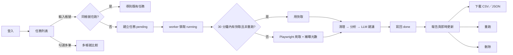

# PRD：Threads 帳號貼文分析工具

> 版本 1.1（2026-11-11）。v1.0 為第二階段筆試提交的〈時間評估與需求釐清〉；本版依 11/11 更新的題目「PRD 撰寫要求」補齊格式，並納入開發中新增的需求（重跑／刪除任務、LLM 建議、曝光數門檻）。變更紀錄見文末。

## 1. 產品目標與問題定義

**要解決的問題**：內容團隊想知道一個 Threads 帳號「什麼內容、什麼時間、什麼寫法」互動最好，但手動逐篇記錄讚數、回覆、曝光既耗時又容易出錯，也無法比較多個帳號。

**目標使用者**：內容企劃、社群小編、行銷分析人員。

**使用情境**：輸入競品或自家的 Threads 帳號 → 幾分鐘後拿到一份報告：整體表現、表現最好的貼文、發文時段、篇幅與寫法的影響、3 點策略觀察與建議 → 匯出 CSV 給團隊，或和其他帳號並排比較。

**成功指標**：
- 一個帳號從送出到出報告 ≤ 5 分鐘。
- 每篇貼文的讚、回覆、轉發、分享、曝光與 Threads 原頁一致。
- 報告中的每一點觀察都附得出計算依據。

**本次不處理**：
- 私人帳號、需要追蹤才能看的內容。
- 長期排程追蹤與趨勢圖（只分析一次快照）。
- 貼文圖片、影片內容分析。
- 自動發文或代為回覆。
- 付費、團隊共用與權限分級。

## 2. 功能描述

| 功能 | 目的 | 觸發條件 | 輸入 | 處理流程 | 輸出 | 使用者可見狀態 |
|---|---|---|---|---|---|---|
| F1 註冊／登入 | 只有登入者能用，資料互相隔離 | 進入任何頁面 | Email、密碼 | Supabase Auth；middleware 檢查 session | 登入後進入任務列表 | 未登入一律導到 /login；錯誤訊息顯示在表單下 |
| F2 建立分析任務 | 開始分析一個帳號 | 按「開始分析」 | 帳號、@帳號或 threads.com／threads.net 網址 | 解析成帳號 → 同帳號已在跑就不重建 → 寫入 `analysis_jobs`（pending） | 導到任務頁 | 排隊中 → 爬取與分析中 → 完成／失敗，以 Realtime 即時更新 |
| F3 資料取得 | 取得最近 30 篇主貼文 | worker 領到任務 | 帳號 | 30 分鐘內有快取就用；否則 Playwright 以副帳號開個人頁，攔截 GraphQL／內嵌 JSON，排除自己回覆的串文；逐篇開貼文頁讀曝光數；失敗重試 3 次 | 原始貼文 | 任務頁「處理者」顯示機器與模式 |
| F4 資料清理 | 讓資料可以分析 | 取得資料後 | 原始貼文 | 去重合併、缺值處理、台灣時間、字數／hashtag／mention／連結數、貼文類型 | `posts` 表 | 報告寫出去重與缺值筆數 |
| F5 數據分析 | 產出指標與洞察 | 清理後 | 清理後貼文 | 平均值、互動率 Top 5、時間分布、篇幅與互動、TF-IDF 關鍵字、類型分布、三群分群與 NLP 原因、3 點觀察 | `analysis_results` 表 | 報告各區塊 |
| F6 LLM 建議 | 把數據轉成可執行建議 | 分析完成且 worker 設定了 API 金鑰 | 彙總數字與代表貼文摘錄 | Claude 依結構化格式產生 3–5 條建議，每條附依據 | `llm_suggestions` 欄位 | 報告「LLM 內容策略建議」區；沒有金鑰時顯示說明 |
| F7 查看報告 | 閱讀結果 | 點任務 | — | 讀取結果與貼文 | 總覽、Top 5、4 張圖、觀察、建議、分群、全部貼文 | — |
| F8 重跑任務 | 取得最新數據 | 任務頁按「重跑」 | 原任務 | 以同帳號建立新任務，`force_refresh = true` 略過快取 | 新任務頁 | 標示「這是重跑的任務」；舊任務保留 |
| F9 刪除任務 | 清除不要的紀錄 | 任務頁按「刪除」 | 任務 id | RLS 只允許刪自己已完成或失敗的任務；貼文與結果 cascade 刪除 | 回列表 | 顯示「已刪除」；執行中的任務沒有刪除鈕 |
| F10 多帳號比較 | 並排比較帳號 | 列表勾選 2 筆以上完成的任務 | 任務 id | 讀各自的總覽 | 比較表 | — |
| F11 匯出 | 給團隊後續使用 | 報告頁按「下載 CSV／JSON」 | 任務 id | API route 以使用者身分讀取（受 RLS 限制） | CSV（含 BOM）、JSON | 直接下載 |

## 3. 使用者流程

User stories：
- 身為內容企劃，我輸入競品帳號網址，5 分鐘內看到它哪幾篇互動最好、為什麼。
- 身為分析人員，我把報告匯出成 CSV，在試算表裡做自己的樞紐分析。
- 身為小編，我勾選自家和兩個競品帳號，並排比較平均互動與互動率。

## 4. 資料與權限

| 資料表 | 主要欄位（型別） | 必填 | 關聯 | 來源 | 讀 | 寫 |
|---|---|---|---|---|---|---|
| `profiles` | id uuid、email text | 是 | auth.users | 註冊時觸發器 | 本人 | 系統 |
| `analysis_jobs` | id uuid、user_id uuid、target_username text（帳號格式 check）、status enum、source enum、force_refresh bool、error text、worker_info text、時間戳 | id、user_id、target_username、status | user → jobs 一對多 | 使用者建立、worker 更新 | 本人 | 本人新增（只能 pending）、本人刪除（只限完成／失敗）、worker 更新狀態 |
| `posts` | post_id text、url、text、posted_at timestamptz、posted_at_local、weekday、hour、likes／replies／reposts／quotes／shares int、views int（可為 null）、char_count、hashtags text[]、mentions text[]、url_count、post_type、interactions、engagement_rate | job_id、user_id、post_id | job → posts 一對多，cascade | worker | 本人 | 只有 worker（service role） |
| `analysis_results` | job_id、summary、cleaning、overview、top5、time_dist、length_rel、post_types、hashtags、correlations、keywords、clusters、groups、observations（jsonb）、llm_suggestions jsonb、llm_model text | job_id、user_id | job → result 一對一，cascade | worker | 本人 | 只有 worker |
| `scrape_cache` | username、source、payload jsonb、fetched_at | 全部 | 不分使用者 | worker | 無（RLS 無 policy） | 只有 worker |

權限原則：所有表開 RLS，`user_id = auth.uid()`；service role 金鑰只在 worker；網站只用 anon 金鑰。Threads 副帳號登入狀態檔不進 git、不進 Docker 映像。

## 5. 例外情境

| 情境 | 偵測方式 | 使用者看到 | 系統行為 |
|---|---|---|---|
| 登入失敗 | Supabase Auth 回傳錯誤 | 「帳號或密碼錯誤」 | 留在登入頁 |
| 輸入格式錯誤 | 解析不出帳號 | 「請輸入 Threads 帳號或帳號網址」 | 不建立任務 |
| 帳號不存在／私人帳號 | 一篇都抓不到 | 任務失敗：「抓不到任何貼文」 | status = failed，可重跑 |
| 資料不足 | 清理後少於 5 篇 | 「資料不足：只取得 N 篇」 | failed |
| 爬取受阻（登入牆） | 頁面出現登入提示 | 「遇到登入牆，抓不到貼文」 | 重試 3 次（2／4／8 秒）後 failed；README 說明可改用 mock 跑通流程 |
| 曝光數缺失 | 貼文頁沒有 impression_count | 報告「缺曝光數 N」 | 存 null，不計入互動率與 Top 5 |
| 其他欄位缺失 | 解析不到 | 報告列出缺幾筆 | 數字補 0、文字補空字串 |
| 逾時／網路錯誤 | Playwright 逾時 | 任務失敗訊息 | 重試 3 次 |
| 重複任務 | 同帳號已有 pending／running | 「這個帳號已經在分析中」 | 導到既有任務，不重建 |
| 分析失敗 | 例外 | 錯誤訊息（前 500 字） | failed，可重跑 |
| LLM 失敗或無金鑰 | API 錯誤、拒答、格式不符 | 「這次沒有產生 LLM 建議」 | 不影響任務，其他分析照常完成 |
| 刪除執行中任務 | RLS 拒絕 | 不顯示刪除鈕；直接呼叫回「無法刪除」 | 不刪 |

## 6. 驗收標準

**F1 登入**
- Given 未登入，When 打開 /dashboard，Then 導到 /login。
- Given 使用者 A 已登入，When 打開使用者 B 的任務網址，Then 顯示 404（RLS 查不到）。
- 邊界：密碼少於 6 碼 → 表單擋下。

**F2 建立任務**
- Given 已登入，When 輸入 `https://www.threads.com/@emoless_com`，Then 建立 target_username = emoless_com 的任務並導到任務頁。
- Given 同帳號已有執行中任務，When 再次送出，Then 不建立新任務，導到既有任務並提示。
- 失敗：輸入 `hello world` → 顯示格式錯誤。

**F3 資料取得**
- Given 公開帳號，When worker 處理，Then 取得 ≥ 30 篇主貼文（帳號不足 30 篇時取全部），不含作者回覆自己的串文。
- Given 30 分鐘內抓過，When 再建任務，Then 使用快取，log 顯示「用快取」。
- 正確性：抽查 2 篇，讚、回覆、轉發、分享、曝光與 Threads 原頁一致。

**F4 清理**
- Given 同一篇出現兩次，Then 只留一筆，欄位取較完整者。
- Given 某篇沒有曝光數，Then views 為 null、互動率為 null，報告寫「缺曝光數 1」。
- 所有時間以 Asia/Taipei 顯示。

**F5 分析**
- Top 5 只排曝光數 ≥ 全體第 25 百分位的貼文；曝光數覆蓋不足一半時改依總互動排序。
- 每點觀察的兩組都至少 3 篇；中位數沒有同方向差 1.5 倍時，標題不得寫成穩定規律。
- 三個群組各有 3–5 篇代表貼文，每篇至少 1 條原因。

**F6 LLM 建議**
- Given worker 有 API 金鑰，Then 產生 3–5 條建議，每條有標題、做法、依據。
- Given 沒有金鑰或呼叫失敗，Then 任務仍為 done，報告顯示說明文字。

**F8 重跑**
- Given 已完成的任務，When 按重跑，Then 建立新任務、force_refresh = true、略過快取；舊任務仍在列表。

**F9 刪除**
- Given 自己已完成的任務，When 按刪除，Then 任務、貼文、結果都刪除，回列表顯示「已刪除」。
- Given 執行中的任務，Then 不顯示刪除鈕；直接呼叫也被 RLS 擋下。

**F10／F11 比較與匯出**
- 勾選 2 筆完成任務 → 比較表列出各帳號指標。
- CSV 以 Excel 開啟中文不亂碼（UTF-8 BOM）；JSON 含任務、貼文、分析結果。

## 7. 非功能需求

| 類別 | 要求 |
|---|---|
| 安全性 | RLS 隔離；service role 金鑰只在 worker；`.env`、登入狀態檔不進 git；匯出 API 以使用者身分查詢 |
| 效能 | 一個帳號 3–5 分鐘（含逐篇補曝光數）；報告頁伺服器端渲染 |
| 可用性 | 狀態即時更新；錯誤訊息用中文說明原因與下一步；手機寬度可讀 |
| 合規 | 只讀公開內容；使用副帳號、低頻率；不繞過驗證機制；README 說明資料來源與限制 |
| 快取 | 同帳號 30 分鐘內重用；快取依資料來源分開，避免 mock 與真實資料混用 |
| 日誌 | worker 記錄每筆任務開始、資料來源、篇數、失敗原因；任務記錄處理者（機器、模式、程序） |
| 測試 | 單元測試涵蓋解析、清理、分析、NLP 特徵；一個測試直接用真實爬到的資料 |
| 部署 | 網站部署 Vercel（Root Directory = web）；worker 常駐本機或 Docker 主機 |
| 環境變數 | 網站：NEXT_PUBLIC_SUPABASE_URL、NEXT_PUBLIC_SUPABASE_ANON_KEY；worker：SUPABASE_URL、SUPABASE_SERVICE_ROLE_KEY、DATA_SOURCE、MAX_POSTS、CACHE_MINUTES、FETCH_VIEWS、BROWSER_CHANNEL、THREADS_STORAGE_STATE、ANTHROPIC_API_KEY（選填） |

## 8. 開發拆解與優先級

每個任務都能在一個 checkpoint（一次 commit）內完成並驗收。時間以 30 分鐘為一個區塊。

| # | 任務 | 優先級 | 依賴 | 預估 | 完成定義 |
|---|---|---|---|---|---|
| 1 | 專案骨架（monorepo：web／worker／shared） | Must | — | 2 區塊 | 三個套件都能 typecheck |
| 2 | Supabase 資料表、RLS、claim_next_job | Must | 1 | 2 區塊 | migration 套用成功、安全檢查無警告 |
| 3 | 登入、middleware、任務列表 | Must | 2 | 3 區塊 | F1、F2 驗收通過 |
| 4 | worker 輪詢、狀態更新、Realtime | Must | 2 | 2 區塊 | 狀態不用重新整理就會更新 |
| 5 | Playwright 爬取（GraphQL 攔截、捲動、排除串文回覆） | Must | 4 | 4 區塊 | 取得 30 篇，抽查與原頁一致 |
| 6 | 逐篇補曝光數、分享數 | Must | 5 | 2 區塊 | 曝光數覆蓋 ≥ 90% |
| 7 | 資料清理 | Must | 5 | 2 區塊 | F4 驗收通過 |
| 8 | 分析指標與 Top 5 門檻 | Must | 7 | 3 區塊 | F5 前兩條通過 |
| 9 | 分群與 NLP 原因 | Must | 8 | 3 區塊 | 每群 3–5 篇附原因 |
| 10 | 報告頁與 4 張圖 | Must | 8 | 3 區塊 | 報告各區顯示正常 |
| 11 | 3 點觀察（含中位數檢查） | Must | 8 | 2 區塊 | F5 第二條通過 |
| 12 | 重跑、刪除、重複任務防呆 | Must | 3 | 2 區塊 | F8、F9 通過 |
| 13 | 快取、重試、錯誤訊息 | Should | 5 | 2 區塊 | 例外情境表逐項可重現 |
| 14 | CSV／JSON 匯出 | Should | 10 | 1 區塊 | F11 通過 |
| 15 | 多帳號比較 | Should | 10 | 1 區塊 | F10 通過 |
| 16 | LLM 建議 | Should | 8 | 2 區塊 | F6 通過 |
| 17 | 單元測試、命令列報告、data／reports | Should | 8 | 2 區塊 | 測試全過，報告可重現 |
| 18 | Docker 設定 | Could | 5 | 1 區塊 | docker compose 設定完成 |
| 19 | README、AI_LOG、部署 Vercel | Must | 全部 | 3 區塊 | 線上版可登入並跑完一個帳號 |

合計約 42 區塊（21 小時）。

## 變更紀錄

| 日期 | 變更 | 原因 |
|---|---|---|
| 10/17 | v1.0：時間評估與需求釐清 | 第二階段筆試 |
| 11/10 | 資料取得改以 Playwright 為主 | 題目指定 Playwright |
| 11/11 | 新增曝光數逐篇補抓、分享數 | 個人頁沒有曝光數；試算表「引用」實為分享數 |
| 11/11 | Top 5 加曝光數門檻 | 剛發的貼文分母太小，互動率失真 |
| 11/11 | 觀察加入至少 3 篇、中位數檢查 | 第二個帳號實測發現少數樣本結論不可靠 |
| 11/11 | 新增重跑、刪除、重複任務防呆、LLM 建議 | 題目更新後的 PRD 要求 |
| 11/12 | 數據分析題改用題目附的試算表 16 篇，補上主題、文型欄，另出作答試算表 | 題目指定的資料是附的試算表 |
