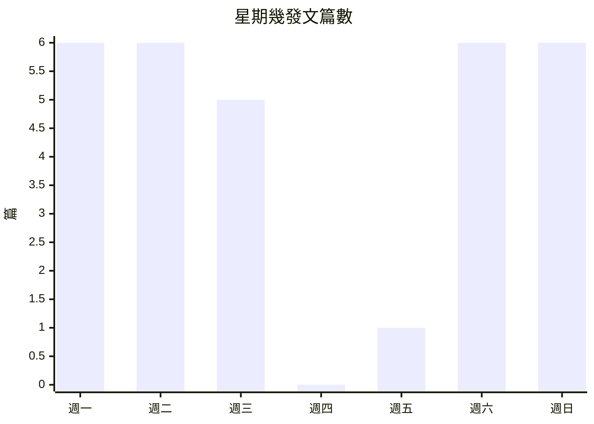
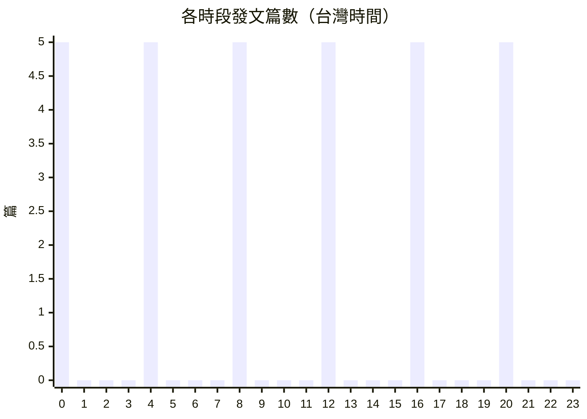
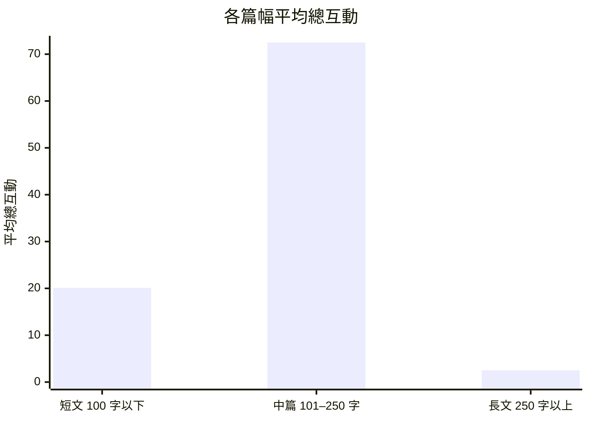

# @emoless_com Threads 貼文分析報告

- 資料來源：playwright（網站 worker 爬取，從 Supabase scrape_cache 匯出）
- 抓取時間：2026-11-11T12:03:21.106Z
- 貼文期間：2026-11-06 20:07 至 2026-11-11 16:01（Asia/Taipei）
- 清理：原始 30 筆，去重 0 筆；缺時間 0、缺曝光 1、缺內文 0

## 總覽指標

| 指標 | 數值 |
|---|---:|
| 貼文數 | 30 |
| 平均讚 | 40.6 |
| 平均回覆 | 11.6 |
| 平均轉發 | 0.2 |
| 平均引用 | 0.1 |
| 平均分享 | 3.1 |
| 平均曝光 | 14120 |
| 平均總互動 | 55.6 |
| 總互動中位數 | 4.5 |
| 整體互動率 | 0.41% |
| 曝光數覆蓋 | 97% |

> 總互動 = 讚 + 回覆 + 轉發 + 引用 + 分享；互動率 = 總互動 ÷ 曝光數。

## 內容策略觀察

1. **互動高度集中在少數爆文**：平均值會被少數爆文拉高，判斷單篇表現時應同時看中位數。值得回頭拆解這幾篇爆文的主題與寫法，找出可以複製的部分。
   - 依據：互動最高的 3 篇占全部 30 篇總互動的 85.7%（平均分配應約 10%）；中位數 4.5，平均 55.6
2. **結尾提問的貼文互動較高**：以問句收尾等於給讀者一個回覆的理由。建議在故事型貼文最後加一句和讀者經驗相關的問題。
   - 依據：結尾提問 3 篇平均互動 170.7（中位數 17）；其餘 27 篇平均 42.9（中位數 4）；平均相差 4 倍
3. **中篇（101–250 字）表現最好**：字數和互動的 Spearman 相關為 0.16。中篇平均互動是短文的 3.6 倍，篇幅可以往這個區間靠攏。
   - 依據：短文 7 篇平均 20.1；中篇 21 篇平均 72.5；長文 2 篇平均 2.5（只比較 3 篇以上的篇幅）

## Top 5 貼文（依互動率）

> 只排曝光數 ≥ 233 的貼文（全體第 25 百分位），避免剛發、曝光很少的貼文因分母小而排在前面。

| # | 內容 | 發文時間 | 讚 | 回覆 | 總互動 | 曝光 | 互動率 |
|---|---|---|---:|---:|---:|---:|---:|
| 1 | [「你要做一個不動聲色的大人了。不准情緒化，不准偷偷想念，不准回頭看。去過自己另外…](https://www.threads.com/@emoless_com/post/DfbRtV5lBXY) | 2026-11-07 12:02 | 60 | 0 | 63 | 4367 | 1.44% |
| 2 | [「生活不需要比別人好，但一定要比以前好；步履不停，便自會有屬於你的花期。」](https://www.threads.com/@emoless_com/post/DfkTLYFmrd9) | 2026-11-11 00:08 | 8 | 0 | 9 | 636 | 1.42% |
| 3 | [我四年級那張聯絡資料，記得幾件事。 第一，媽媽再婚，我還是寫原本的姓。 第二，緊…](https://www.threads.com/@emoless_com/post/Dfj54s8m-9f) | 2026-11-10 20:27 | 1 | 4 | 5 | 558 | 0.90% |
| 4 | [四點五十分，我在幼兒園門口滑到婆婆的貼文。 她說阿嬤只是高興，朋友一直問孫子，照…](https://www.threads.com/@emoless_com/post/DfjDhyNlHtw) | 2026-11-10 12:32 | 0 | 4 | 4 | 475 | 0.84% |
| 5 | [阿嬤住進照護機構後，我通常星期日下午去看她。第一次帶了一大袋水果，護理人員說不用…](https://www.threads.com/@emoless_com/post/DfiNgtlj3w4) | 2026-11-10 04:40 | 5 | 3 | 8 | 1071 | 0.75% |

## 發文時間分布

最常發文：週一、0 點；平均互動最高（至少 2 篇）：週日、0 點。

| 星期 | 篇數 | 平均總互動 |
|---|---:|---:|
| 週一 | 6 | 4.7 |
| 週二 | 6 | 4.2 |
| 週三 | 5 | 5 |
| 週四 | 0 | 0 |
| 週五 | 1 | 0 |
| 週六 | 6 | 100.3 |
| 週日 | 6 | 164.8 |

## 文字長度與互動

Spearman：字數 × 總互動 0.16；字數 × 互動率 -0.22。

| 篇幅 | 篇數 | 平均總互動 | 平均互動率 |
|---|---:|---:|---:|
| 短文（100 字以下） | 7 | 20.1 | 2.12% |
| 中篇（101–250 字） | 21 | 72.5 | 1.65% |
| 長文（250 字以上） | 2 | 2.5 | 0.49% |

## 貼文類型

| 類型 | 篇數 | 占比 | 平均總互動 | 平均互動率 |
|---|---:|---:|---:|---:|
| 純文字 | 30 | 100% | 55.6 | 1.68% |
| 含連結 | 0 | 0% | 0 | — |
| 含 hashtag | 0 | 0% | 0 | — |
| 含 mention | 0 | 0% | 0 | — |
| 混合 | 0 | 0% | 0 | — |

## 關鍵字與 Hashtag

- 關鍵字（TF-IDF，出現 2 篇以上）：回去、地方、有些、回頭、以前、生活、那天、後來、看看、今天、過去、很久、坐在、走了、小時候、時間、阿嬤、東西、別人、一會兒
- Hashtag：這段期間沒有使用

## 分群與 NLP 分析

分群：讚數與回覆數各取百分位排名後平均，三等分。每篇代表貼文都用同一套文本特徵分析，方向由全體貼文的 Spearman 相關決定。

### 高互動群（10 篇）：一半・每次・開始

高互動群與全體差最多的是：具體數字 3（全體 2.1）；敘事時間標記 2.7（全體 2）；對話 0.3（全體 0.6）。群內區辨詞：一半、每次、開始。

- [晚上十點零七分，先生傳本月家用給我。 一萬六，叫我出八千。 …](https://www.threads.com/@emoless_com/post/Dfckyvmmzab)（讚 557、回覆 231）
  - 加分：具體數字較多（4 處，全體平均 2.1）（此特徵與互動 ρ=0.25）
  - 加分：沒有對話或引述（此特徵與互動 ρ=-0.13）
  - 加分：句子較多（12 句，全體平均 10.1）（此特徵與互動 ρ=0.15）
- [「家屬往這邊，朋友往後面。」 禮儀人員拿著簽到簿，等我回答。…](https://www.threads.com/@emoless_com/post/DfdcEYvmS45)（讚 29、回覆 7）
  - 加分：敘事時間標記較多，有故事時間線（4 個，全體平均 2）（此特徵與互動 ρ=0.24）
  - 加分：句子較多（17 句，全體平均 10.1）（此特徵與互動 ρ=0.15）
  - 加分：具體數字較多（3 處，全體平均 2.1）（此特徵與互動 ρ=0.25）
- [我坐在沙發旁邊，把延長線一孔一孔拔掉。 用不到這麼多了。 以…](https://www.threads.com/@emoless_com/post/DfmAPYlG4ib)（讚 3、回覆 4）
  - 加分：具體數字較多（3 處，全體平均 2.1）（此特徵與互動 ρ=0.25）
  - 加分：沒有對話或引述（此特徵與互動 ρ=-0.13）
  - 加分：句子較多（12 句，全體平均 10.1）（此特徵與互動 ρ=0.15）
- [女兒搬出去那天，嫌我塞太多東西。 水果、衛生紙、冷凍水餃，…](https://www.threads.com/@emoless_com/post/Dfa2IN5mTSi)（讚 8、回覆 2）
  - 加分：敘事時間標記較多，有故事時間線（4 個，全體平均 2）（此特徵與互動 ρ=0.24）
  - 加分：具體數字較多（3 處，全體平均 2.1）（此特徵與互動 ρ=0.25）
  - 加分：沒有對話或引述（此特徵與互動 ρ=-0.13）

### 中互動群（10 篇）：我知道・都沒・東西

中互動群與全體差最多的是：結尾提問 0（全體 0.1）；第一人稱密度（每百字「我」） 3.3（全體 2.9）。群內區辨詞：我知道、都沒、東西。

- [我四年級那張聯絡資料，記得幾件事。 第一，媽媽再婚，我還是寫…](https://www.threads.com/@emoless_com/post/Dfj54s8m-9f)（讚 1、回覆 4）
  - 加分：沒有對話或引述（此特徵與互動 ρ=-0.13）
  - 加分：句子較多（13 句，全體平均 10.1）（此特徵與互動 ρ=0.15）
  - 扣分：具體數字較少（1 處，全體平均 2.1）（此特徵與互動 ρ=0.25）
  - 扣分：沒有以問句結尾（此特徵與互動 ρ=0.17）
- [「你要做一個不動聲色的大人了。不准情緒化，不准偷偷想念，不准…](https://www.threads.com/@emoless_com/post/DfbRtV5lBXY)（讚 60、回覆 0）
  - 扣分：敘事時間標記較少，較像片段感想（0 個，全體平均 2）（此特徵與互動 ρ=0.24）
  - 扣分：篇幅較短（58 字，全體平均 161.7）（此特徵與互動 ρ=0.16）
- [六頁。我坐在影印店，算自己這次面試做了多少東西。 一份新品活…](https://www.threads.com/@emoless_com/post/DfkupNVgZcv)（讚 0、回覆 4）
  - 加分：句子較多（15 句，全體平均 10.1）（此特徵與互動 ρ=0.15）
  - 加分：沒有對話或引述（此特徵與互動 ρ=-0.13）
  - 扣分：敘事時間標記較少，較像片段感想（1 個，全體平均 2）（此特徵與互動 ρ=0.24）
  - 扣分：具體數字較少（1 處，全體平均 2.1）（此特徵與互動 ρ=0.25）
- [離職那天，同事說改天約吃飯，我說好，群組先不要踢我，還有幾個…](https://www.threads.com/@emoless_com/post/DfipxyYGOgW)（讚 2、回覆 1）
  - 加分：敘事時間標記較多，有故事時間線（5 個，全體平均 2）（此特徵與互動 ρ=0.24）
  - 加分：沒有對話或引述（此特徵與互動 ρ=-0.13）
  - 扣分：具體數字較少（0 處，全體平均 2.1）（此特徵與互動 ρ=0.25）
  - 扣分：句子較少（6 句，全體平均 10.1）（此特徵與互動 ρ=0.15）

### 低互動群（10 篇）：桌上・先把・地方

低互動群與全體差最多的是：敘事時間標記 1（全體 2）；情緒詞 0.2（全體 0.6）；具體數字 1.3（全體 2.1）。群內區辨詞：桌上、先把、地方。

- [「妳幫我穿一下。」 阿嬤把針遞過來，我坐到她旁邊。 以前都是…](https://www.threads.com/@emoless_com/post/DfgBUotmYie)（讚 0、回覆 4）
  - 扣分：敘事時間標記較少，較像片段感想（1 個，全體平均 2）（此特徵與互動 ρ=0.24）
  - 扣分：情緒詞較少（0 個，全體平均 0.6）（此特徵與互動 ρ=0.13）
  - 扣分：有對話或引述（1 處，全體平均 0.6）（此特徵與互動 ρ=-0.13）
- [「生活不需要比別人好，但一定要比以前好；步履不停，便自會有屬…](https://www.threads.com/@emoless_com/post/DfkTLYFmrd9)（讚 8、回覆 0）
  - 扣分：敘事時間標記較少，較像片段感想（0 個，全體平均 2）（此特徵與互動 ρ=0.24）
  - 扣分：具體數字較少（0 處，全體平均 2.1）（此特徵與互動 ρ=0.25）
  - 扣分：篇幅較短（37 字，全體平均 161.7）（此特徵與互動 ρ=0.16）
- [小時候怕天黑，總盼著有人來接。長大後走了很久的夜路，才慢慢不…](https://www.threads.com/@emoless_com/post/DfjeE9_m1ig)（讚 1、回覆 0）
  - 扣分：敘事時間標記較少，較像片段感想（0 個，全體平均 2）（此特徵與互動 ρ=0.24）
  - 扣分：具體數字較少（0 處，全體平均 2.1）（此特徵與互動 ρ=0.25）
  - 扣分：篇幅較短（35 字，全體平均 161.7）（此特徵與互動 ρ=0.16）
- [今天去拿修改好的西裝，老闆說腰放了兩吋，穿起來應該比較舒服。…](https://www.threads.com/@emoless_com/post/Dfg6T8imy59)（讚 0、回覆 0）
  - 扣分：具體數字較少（0 處，全體平均 2.1）（此特徵與互動 ρ=0.25）
  - 扣分：句子較少（8 句，全體平均 10.1）（此特徵與互動 ρ=0.15）
  - 扣分：沒有以問句結尾（此特徵與互動 ρ=0.17）

## 全部貼文（清理後）

| 時間 | 內容 | 類型 | 字數 | 讚 | 回覆 | 轉發 | 引用 | 分享 | 曝光 | 互動率 |
|---|---|---|---:|---:|---:|---:|---:|---:|---:|---:|
| 2026-11-11 16:01 | [我坐在沙發旁邊，把延長線一孔一孔拔掉。 用不到這…](https://www.threads.com/@emoless_com/post/DfmAPYlG4ib) | 純文字 | 188 | 3 | 4 | 0 | 0 | 0 | — | — |
| 2026-11-11 12:43 | [「日子很長，過去的就讓它翻篇，未來的就留給時間，…](https://www.threads.com/@emoless_com/post/DflplKLlE7r) | 純文字 | 34 | 3 | 1 | 0 | 0 | 0 | 43 | 9.30% |
| 2026-11-11 08:13 | [有一陣子過得很差，房間亂到連朋友來都不好意思開門…](https://www.threads.com/@emoless_com/post/DflKrvbD7Ok) | 純文字 | 184 | 1 | 0 | 0 | 0 | 0 | 139 | 0.72% |
| 2026-11-11 04:08 | [六頁。我坐在影印店，算自己這次面試做了多少東西。…](https://www.threads.com/@emoless_com/post/DfkupNVgZcv) | 純文字 | 179 | 0 | 4 | 0 | 0 | 0 | 24 | 16.67% |
| 2026-11-11 00:08 | [「生活不需要比別人好，但一定要比以前好；步履不停…](https://www.threads.com/@emoless_com/post/DfkTLYFmrd9) | 純文字 | 37 | 8 | 0 | 1 | 0 | 0 | 636 | 1.42% |
| 2026-11-10 20:27 | [我四年級那張聯絡資料，記得幾件事。 第一，媽媽再…](https://www.threads.com/@emoless_com/post/Dfj54s8m-9f) | 純文字 | 196 | 1 | 4 | 0 | 0 | 0 | 558 | 0.90% |
| 2026-11-10 16:24 | [小時候怕天黑，總盼著有人來接。長大後走了很久的夜…](https://www.threads.com/@emoless_com/post/DfjeE9_m1ig) | 純文字 | 35 | 1 | 0 | 0 | 0 | 0 | 52 | 1.92% |
| 2026-11-10 12:32 | [四點五十分，我在幼兒園門口滑到婆婆的貼文。 她說…](https://www.threads.com/@emoless_com/post/DfjDhyNlHtw) | 純文字 | 183 | 0 | 4 | 0 | 0 | 0 | 475 | 0.84% |
| 2026-11-10 08:47 | [離職那天，同事說改天約吃飯，我說好，群組先不要踢…](https://www.threads.com/@emoless_com/post/DfipxyYGOgW) | 純文字 | 158 | 2 | 1 | 0 | 0 | 0 | 80 | 3.75% |
| 2026-11-10 04:40 | [阿嬤住進照護機構後，我通常星期日下午去看她。第一…](https://www.threads.com/@emoless_com/post/DfiNgtlj3w4) | 純文字 | 172 | 5 | 3 | 0 | 0 | 0 | 1071 | 0.75% |
| 2026-11-10 00:09 | [六千四。游泳池櫃檯說八堂，把報名表推給我。 含泳…](https://www.threads.com/@emoless_com/post/Dfhufz2mu8y) | 純文字 | 203 | 0 | 4 | 0 | 0 | 0 | 148 | 2.70% |
| 2026-11-09 20:11 | [「我們總說等忙完這陣子，就回去看看。直到老屋換了…](https://www.threads.com/@emoless_com/post/DfhTQm9G3Zj) | 純文字 | 49 | 0 | 0 | 0 | 0 | 0 | 556 | 0.00% |
| 2026-11-09 16:33 | [今天去拿修改好的西裝，老闆說腰放了兩吋，穿起來應…](https://www.threads.com/@emoless_com/post/Dfg6T8imy59) | 純文字 | 151 | 0 | 0 | 0 | 0 | 0 | 233 | 0.00% |
| 2026-11-09 12:26 | [分手後，她來搬了兩次東西。第一次搬衣服和書，第二…](https://www.threads.com/@emoless_com/post/DfgeDAMFPYV) | 純文字 | 360 | 1 | 2 | 0 | 0 | 0 | 436 | 0.69% |
| 2026-11-09 08:15 | [「妳幫我穿一下。」 阿嬤把針遞過來，我坐到她旁邊…](https://www.threads.com/@emoless_com/post/DfgBUotmYie) | 純文字 | 184 | 0 | 4 | 0 | 0 | 0 | 207 | 1.93% |
| 2026-11-09 04:21 | [空窗四個月，今天終於收到錄取通知。 薪水比以前…](https://www.threads.com/@emoless_com/post/DffmioUAUcI) | 純文字 | 242 | 16 | 1 | 0 | 0 | 0 | 3140 | 0.54% |
| 2026-11-09 00:12 | [下午四點二十，我坐在阿嬤家客廳，看阿公幫她綁頭髮…](https://www.threads.com/@emoless_com/post/DffKC2-m-p1) | 純文字 | 184 | 0 | 4 | 0 | 0 | 0 | 601 | 0.67% |
| 2026-11-08 20:06 | [「從前受了委屈，總想找個人說清楚。後來回到家，把…](https://www.threads.com/@emoless_com/post/Dfet5GmGyVt) | 純文字 | 44 | 61 | 2 | 1 | 0 | 0 | 8701 | 0.74% |
| 2026-11-08 16:49 | [男友媽媽坐在我家床沿說：「趁天氣好幫妳曬，晚上才…](https://www.threads.com/@emoless_com/post/DfeXWSVG3qo) | 純文字 | 200 | 1 | 4 | 0 | 0 | 0 | 1331 | 0.38% |
| 2026-11-08 12:34 | [東西比想像中多。租屋處裝了 11 個紙箱，房間只…](https://www.threads.com/@emoless_com/post/Dfd6MlaGxKv) | 純文字 | 251 | 2 | 0 | 0 | 0 | 0 | 694 | 0.29% |
| 2026-11-08 08:11 | [「家屬往這邊，朋友往後面。」 禮儀人員拿著簽到簿…](https://www.threads.com/@emoless_com/post/DfdcEYvmS45) | 純文字 | 197 | 29 | 7 | 0 | 0 | 0 | 19275 | 0.19% |
| 2026-11-08 04:02 | [媽媽第一次來我的租屋處，帶了兩袋菜，卻只坐半個小…](https://www.threads.com/@emoless_com/post/Dfc_ksPj96a) | 純文字 | 158 | 9 | 0 | 0 | 0 | 0 | 1985 | 0.45% |
| 2026-11-08 00:08 | [晚上十點零七分，先生傳本月家用給我。 一萬六，叫…](https://www.threads.com/@emoless_com/post/Dfckyvmmzab) | 純文字 | 179 | 557 | 231 | 3 | 1 | 81 | 130031 | 0.67% |
| 2026-11-07 20:14 | [待業第 58 天，今天去面試，提早了 25 分鐘…](https://www.threads.com/@emoless_com/post/DfcKA16m_pq) | 純文字 | 226 | 420 | 62 | 0 | 0 | 11 | 219650 | 0.22% |
| 2026-11-07 16:06 | [分手一年，洗衣機終於壞了。師傅拆開底下的蓋子，撿…](https://www.threads.com/@emoless_com/post/DfbtobKG4SF) | 純文字 | 173 | 23 | 1 | 0 | 0 | 1 | 9334 | 0.27% |
| 2026-11-07 12:02 | [「你要做一個不動聲色的大人了。不准情緒化，不准偷…](https://www.threads.com/@emoless_com/post/DfbRtV5lBXY) | 純文字 | 58 | 60 | 0 | 1 | 1 | 1 | 4367 | 1.44% |
| 2026-11-07 08:01 | [女兒搬出去那天，嫌我塞太多東西。 水果、衛生紙…](https://www.threads.com/@emoless_com/post/Dfa2IN5mTSi) | 純文字 | 205 | 8 | 2 | 0 | 0 | 0 | 1495 | 0.67% |
| 2026-11-07 04:32 | [我蹲在動物醫院的診療台旁邊，手上拿著牽繩。 豆皮…](https://www.threads.com/@emoless_com/post/DfaeNgTj3m6) | 純文字 | 190 | 7 | 4 | 0 | 0 | 0 | 1834 | 0.60% |
| 2026-11-07 00:46 | [有一陣子過得很差，房間亂到連朋友來都不好意思開門…](https://www.threads.com/@emoless_com/post/DfaEWTFG3sX) | 純文字 | 184 | 0 | 0 | 0 | 0 | 0 | 989 | 0.00% |
| 2026-11-06 20:07 | [「有些告別，當時只當是尋常的一天。隔了好多年才想…](https://www.threads.com/@emoless_com/post/DfZkawbG7qM) | 純文字 | 46 | 0 | 0 | 0 | 0 | 0 | 1396 | 0.00% |
