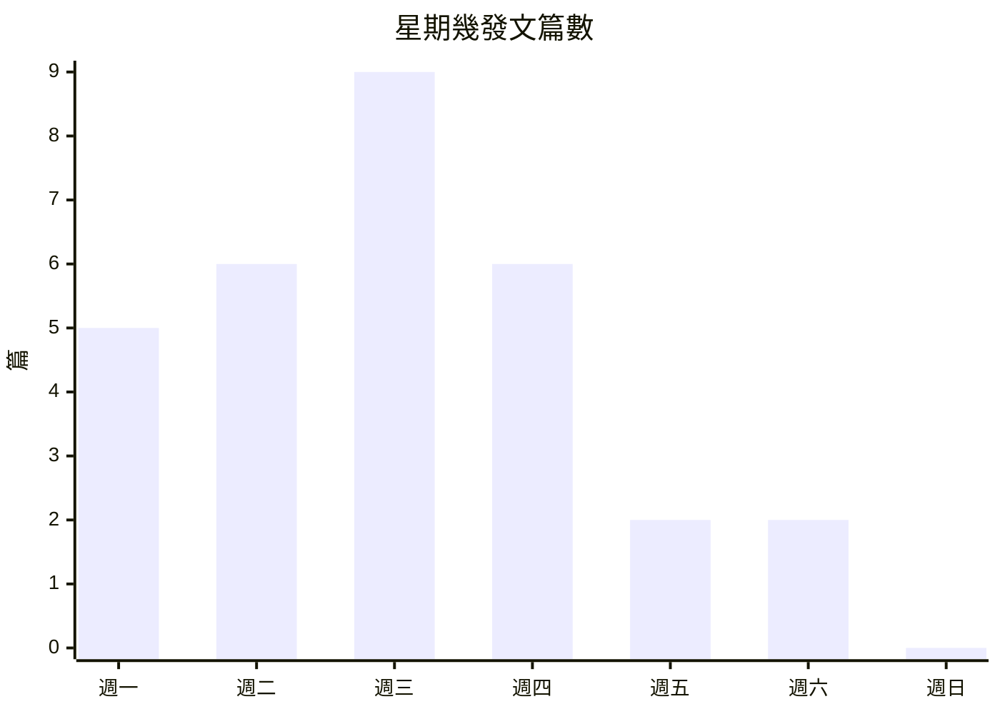
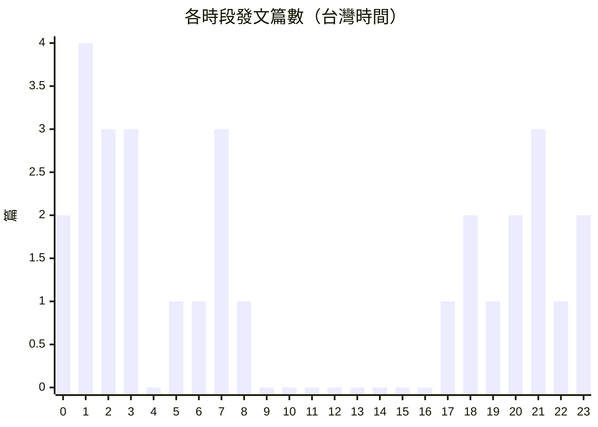
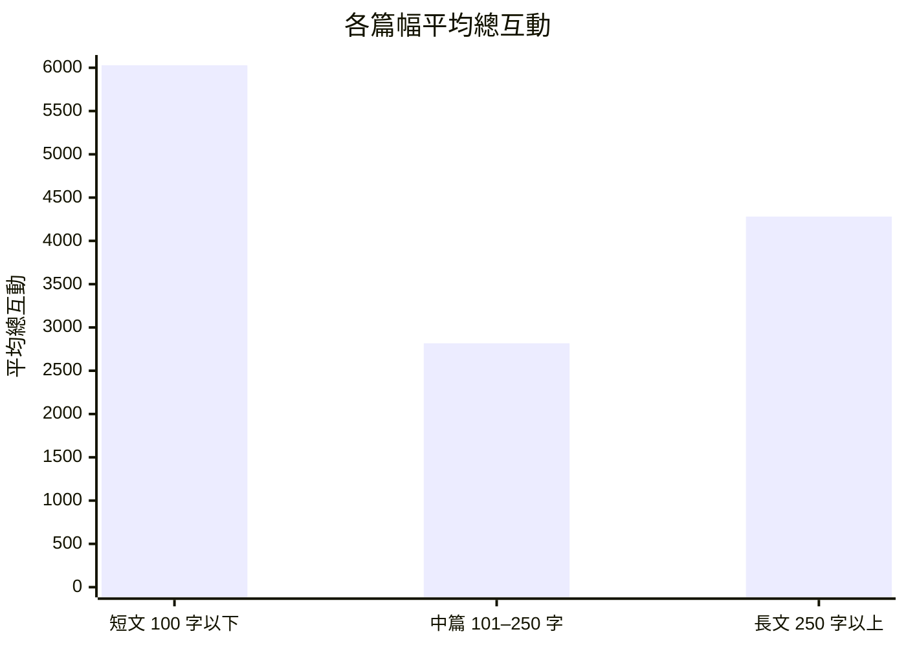

# @zuck Threads 貼文分析報告

- 資料來源：playwright（網站 worker 爬取，從 Supabase scrape_cache 匯出）
- 抓取時間：2026-11-11T12:10:22.089Z
- 貼文期間：2026-04-08 23:59 至 2026-11-10 07:31（Asia/Taipei）
- 清理：原始 30 筆，去重 0 筆；缺時間 0、缺曝光 0、缺內文 0

## 總覽指標

| 指標 | 數值 |
|---|---:|
| 貼文數 | 30 |
| 平均讚 | 2893.5 |
| 平均回覆 | 852.7 |
| 平均轉發 | 166.4 |
| 平均引用 | 57.4 |
| 平均分享 | 152 |
| 平均曝光 | 415997 |
| 平均總互動 | 4122.1 |
| 總互動中位數 | 3229 |
| 整體互動率 | 0.99% |
| 曝光數覆蓋 | 100% |

> 總互動 = 讚 + 回覆 + 轉發 + 引用 + 分享；互動率 = 總互動 ÷ 曝光數。

## 內容策略觀察

1. **「純文字」貼文的互動高於「含連結」**：在可比較的類型裡，純文字平均互動是含連結的 2.2 倍。
   - 依據：純文字 20 篇平均 4,745.9；含連結 7 篇平均 2,160.7；含 mention 3 篇平均 4,539.7
2. **短文（100 字以下）表現最好**：字數和互動的 Spearman 相關為 -0.09。短文平均互動是中篇的 2.1 倍，篇幅可以往這個區間靠攏。
   - 依據：短文 9 篇平均 6,028.9；中篇 14 篇平均 2,816.9；長文 7 篇平均 4,280.7（只比較 3 篇以上的篇幅）
3. **週二發的貼文平均互動最高**：在有 3 篇以上的日子裡，週二的平均互動最高。重要內容可以優先排在週二，再觀察是否穩定。
   - 依據：週二 6 篇平均互動 7,349.7；全體平均 4,122.1（1.8 倍）

## Top 5 貼文（依互動率）

> 只排曝光數 ≥ 180790 的貼文（全體第 25 百分位），避免剛發、曝光很少的貼文因分母小而排在前面。

| # | 內容 | 發文時間 | 讚 | 回覆 | 總互動 | 曝光 | 互動率 |
|---|---|---|---:|---:|---:|---:|---:|
| 1 | [Today we're sharing our new model family…](https://www.threads.com/@zuck/post/DW4Gb79kQc0) | 2026-04-08 23:59 | 2969 | 687 | 4285 | 214939 | 1.99% |
| 2 | [Agrippa said it's time to get back to wo…](https://www.threads.com/@zuck/post/Ddt7cL5EfUG) | 2026-09-26 00:50 | 5225 | 599 | 6286 | 355031 | 1.77% |
| 3 | [Tried to get the family to dress as burg…](https://www.threads.com/@zuck/post/DfNR0zhEdWv) | 2026-11-02 01:33 | 4426 | 809 | 5569 | 363444 | 1.53% |
| 4 | [Our new line of @metaglasses is availabl…](https://www.threads.com/@zuck/post/DZ7eGA1G7wU) | 2026-06-23 20:57 | 3835 | 1376 | 5822 | 420295 | 1.39% |
| 5 | [Announcing Muse Code beta, our multi-age…](https://www.threads.com/@zuck/post/Dbq20Xaj8RL) | 2026-08-06 03:09 | 2660 | 316 | 3465 | 253156 | 1.37% |

## 發文時間分布

最常發文：週三、1 點；平均互動最高（至少 2 篇）：週二、18 點。

| 星期 | 篇數 | 平均總互動 |
|---|---:|---:|
| 週一 | 5 | 4041.8 |
| 週二 | 6 | 7349.7 |
| 週三 | 9 | 2918.9 |
| 週四 | 6 | 3141.2 |
| 週五 | 2 | 2434 |
| 週六 | 2 | 4685 |
| 週日 | 0 | 0 |

## 文字長度與互動

Spearman：字數 × 總互動 -0.09；字數 × 互動率 -0.33。

| 篇幅 | 篇數 | 平均總互動 | 平均互動率 |
|---|---:|---:|---:|
| 短文（100 字以下） | 9 | 6028.9 | 1.70% |
| 中篇（101–250 字） | 14 | 2816.9 | 1.10% |
| 長文（250 字以上） | 7 | 4280.7 | 0.97% |

## 貼文類型

| 類型 | 篇數 | 占比 | 平均總互動 | 平均互動率 |
|---|---:|---:|---:|---:|
| 純文字 | 20 | 67% | 4745.9 | 1.35% |
| 含連結 | 7 | 23% | 2160.7 | 1.01% |
| 含 hashtag | 0 | 0% | 0 | — |
| 含 mention | 3 | 10% | 4539.7 | 1.15% |
| 混合 | 0 | 0% | 0 | — |

## 關鍵字與 Hashtag

- 關鍵字（TF-IDF，出現 2 篇以上）：muse、meta、connect、model、work、ai、family、everyone、coming、everything、spark、future、build、superintelligence、believe、first、wrote、positive、real、world
- Hashtag：這段期間沒有使用

## 分群與 NLP 分析

分群：讚數與回覆數各取百分位排名後平均，三等分。每篇代表貼文都用同一套文本特徵分析，方向由全體貼文的 Spearman 相關決定。

### 高互動群（10 篇）：ai・meta・available

高互動群的文本特徵接近全體平均。群內區辨詞：ai、meta、available。

- [500M monthly actives on Thread…](https://www.threads.com/@zuck/post/DZpPDXbCeTt)（讚 18078、回覆 4695）
  - 加分：句子較少（1 句，全體平均 1.5）（此特徵與互動 ρ=-0.19）
- [Our new line of @metaglasses i…](https://www.threads.com/@zuck/post/DZ7eGA1G7wU)（讚 3835、回覆 1376）
  - 加分：句子較少（1 句，全體平均 1.5）（此特徵與互動 ρ=-0.19）
- [We believe superintelligence w…](https://www.threads.com/@zuck/post/Dd1MqfcG0aH)（讚 2805、回覆 2603）
  - 加分：句子較少（1 句，全體平均 1.5）（此特徵與互動 ρ=-0.19）
- [Today we're releasing Muse Spa…](https://www.threads.com/@zuck/post/DakyAavlKLZ)（讚 2995、回覆 822）
  - 加分：句子較少（1 句，全體平均 1.5）（此特徵與互動 ρ=-0.19）

### 中互動群（10 篇）：1.2・app・everything

中互動群與全體差最多的是：具體數字 0.3（全體 0.8）。群內區辨詞：1.2、app、everything。

- [I believe everyone should have…](https://www.threads.com/@zuck/post/Db2v6H6kUkq)（讚 2220、回覆 964）
  - 加分：句子較少（1 句，全體平均 1.5）（此特徵與互動 ρ=-0.19）
- [Here's everything I announced …](https://www.threads.com/@zuck/post/Ddpj4YZkd3P)（讚 2764、回覆 630）
  - 加分：句子較少（1 句，全體平均 1.5）（此特徵與互動 ρ=-0.19）
- [Announcing Muse Code beta, our…](https://www.threads.com/@zuck/post/Dbq20Xaj8RL)（讚 2660、回覆 316）
  - 扣分：句子較多（3 句，全體平均 1.5）（此特徵與互動 ρ=-0.19）
- [Today Biohub is sharing a majo…](https://www.threads.com/@zuck/post/DY11ZLWG_eY)（讚 2105、回覆 482）
  - 加分：句子較少（1 句，全體平均 1.5）（此特徵與互動 ρ=-0.19）

### 低互動群（10 篇）：coming・cure・diseases

低互動群與全體差最多的是：具體數字 1.3（全體 0.8）；句數 1.8（全體 1.5）。群內區辨詞：coming、cure、diseases。

- [Muse for Mac is out today! It …](https://www.threads.com/@zuck/post/DdZ7sQvkTFn)（讚 1859、回覆 309）
  - 扣分：句子較多（2 句，全體平均 1.5）（此特徵與互動 ρ=-0.19）
- [As part of our philanthropic w…](https://www.threads.com/@zuck/post/DXt5n9UlLl-)（讚 1611、回覆 417）
  - 文本特徵與全體差異不大，互動偏低可能來自主題或發文時機
- [Muse Code is out of beta and n…](https://www.threads.com/@zuck/post/DctzH2RGuC7)（讚 1553、回覆 259）
  - 扣分：句子較多（2 句，全體平均 1.5）（此特徵與互動 ρ=-0.19）
- [Muse Voice Transcribe is MSL's…](https://www.threads.com/@zuck/post/DcwLClnmOrR)（讚 1440、回覆 208）
  - 文本特徵與全體差異不大，互動偏低可能來自主題或發文時機

## 全部貼文（清理後）

| 時間 | 內容 | 類型 | 字數 | 讚 | 回覆 | 轉發 | 引用 | 分享 | 曝光 | 互動率 |
|---|---|---|---:|---:|---:|---:|---:|---:|---:|---:|
| 2026-11-10 07:31 | [Pavlova with Muse helpin…](https://www.threads.com/@zuck/post/DfihFPxkaZ1) | 純文字 | 64 | 1161 | 129 | 36 | 4 | 26 | 68257 | 1.99% |
| 2026-11-07 02:06 | [Using our new spaces fea…](https://www.threads.com/@zuck/post/DfaNgswkQPG) | 純文字 | 199 | 2313 | 519 | 102 | 31 | 119 | 646600 | 0.48% |
| 2026-11-06 02:32 | [Now in the Muse app: tal…](https://www.threads.com/@zuck/post/DfXrs6RGonx) | 純文字 | 70 | 1710 | 584 | 78 | 18 | 65 | 825003 | 0.30% |
| 2026-11-02 01:33 | [Tried to get the family …](https://www.threads.com/@zuck/post/DfNR0zhEdWv) | 純文字 | 74 | 4426 | 809 | 189 | 38 | 107 | 363444 | 1.53% |
| 2026-10-13 00:56 | [Introducing Muse Wonder,…](https://www.threads.com/@zuck/post/DeZtp-TkQHh) | 純文字 | 116 | 2295 | 678 | 180 | 71 | 150 | 313898 | 1.07% |
| 2026-10-12 23:01 | [Muse ordered me 🍉 how th…](https://www.threads.com/@zuck/post/DeZgeQhm6RW) | 純文字 | 28 | 1733 | 532 | 116 | 43 | 77 | 160276 | 1.56% |
| 2026-09-28 20:35 | [We believe superintellig…](https://www.threads.com/@zuck/post/Dd1MqfcG0aH) | 純文字 | 310 | 2805 | 2603 | 166 | 150 | 182 | 466625 | 1.27% |
| 2026-09-26 00:50 | [Agrippa said it's time t…](https://www.threads.com/@zuck/post/Ddt7cL5EfUG) | 純文字 | 35 | 5225 | 599 | 266 | 45 | 151 | 355031 | 1.77% |
| 2026-09-24 08:07 | [Here's everything I anno…](https://www.threads.com/@zuck/post/Ddpj4YZkd3P) | 純文字 | 45 | 2764 | 630 | 165 | 34 | 142 | 335019 | 1.11% |
| 2026-09-24 07:03 | [Lots of announcements co…](https://www.threads.com/@zuck/post/DdpclX0ETvV) | 含連結 | 102 | 1011 | 103 | 68 | 9 | 31 | 908452 | 0.13% |
| 2026-09-24 01:01 | [Excited to see you at Me…](https://www.threads.com/@zuck/post/DdoxAnGDrMh) | 純文字 | 34 | 3075 | 541 | 201 | 50 | 106 | 100111 | 3.97% |
| 2026-09-18 06:27 | [Muse for Mac is out toda…](https://www.threads.com/@zuck/post/DdZ7sQvkTFn) | 含連結 | 169 | 1859 | 309 | 128 | 28 | 89 | 170646 | 1.41% |
| 2026-09-16 07:01 | [Last month I wrote about…](https://www.threads.com/@zuck/post/DdU1-6okapE) | 含連結 | 236 | 1677 | 390 | 127 | 26 | 114 | 150497 | 1.55% |
| 2026-09-09 02:56 | [Introducing @Muse, the p…](https://www.threads.com/@zuck/post/DdCYWl7GktV) | 含 mention | 322 | 3174 | 1704 | 261 | 137 | 323 | 671252 | 0.83% |
| 2026-09-03 03:26 | [Muse Spark 1.3 is rollin…](https://www.threads.com/@zuck/post/Dcy_A8pGo-m) | 純文字 | 205 | 1664 | 268 | 129 | 29 | 91 | 189493 | 1.15% |
| 2026-09-02 01:18 | [Muse Voice Transcribe is…](https://www.threads.com/@zuck/post/DcwLClnmOrR) | 純文字 | 173 | 1440 | 208 | 117 | 24 | 95 | 100647 | 1.87% |
| 2026-09-01 03:06 | [Muse Code is out of beta…](https://www.threads.com/@zuck/post/DctzH2RGuC7) | 含連結 | 160 | 1553 | 259 | 108 | 44 | 69 | 209010 | 0.97% |
| 2026-08-10 18:01 | [Today we're also opening…](https://www.threads.com/@zuck/post/Db2wI-DilLt) | 純文字 | 292 | 1979 | 473 | 88 | 45 | 91 | 331345 | 0.81% |
| 2026-08-10 17:59 | [I believe everyone shoul…](https://www.threads.com/@zuck/post/Db2v6H6kUkq) | 含連結 | 170 | 2220 | 964 | 186 | 79 | 108 | 368603 | 0.96% |
| 2026-08-06 03:09 | [Announcing Muse Code bet…](https://www.threads.com/@zuck/post/Dbq20Xaj8RL) | 純文字 | 323 | 2660 | 316 | 167 | 57 | 265 | 253156 | 1.37% |
| 2026-07-29 01:43 | [I wrote about why we bel…](https://www.threads.com/@zuck/post/DbWGm5emtNl) | 含連結 | 195 | 1494 | 466 | 152 | 48 | 87 | 144439 | 1.56% |
| 2026-07-09 22:00 | [Today we're releasing Mu…](https://www.threads.com/@zuck/post/DakyAavlKLZ) | 純文字 | 127 | 2995 | 822 | 197 | 60 | 197 | 606197 | 0.70% |
| 2026-06-23 20:57 | [Our new line of @metagla…](https://www.threads.com/@zuck/post/DZ7eGA1G7wU) | 含 mention | 145 | 3835 | 1376 | 245 | 119 | 247 | 420295 | 1.39% |
| 2026-06-16 18:59 | [500M monthly actives on …](https://www.threads.com/@zuck/post/DZpPDXbCeTt) | 純文字 | 81 | 18078 | 4695 | 581 | 248 | 498 | 2263345 | 1.06% |
| 2026-06-10 21:41 | [Interesting Biohub conve…](https://www.threads.com/@zuck/post/DZaExc0ESvs) | 含連結 | 406 | 897 | 309 | 60 | 27 | 26 | 274461 | 0.48% |
| 2026-06-09 05:20 | [America is going to need…](https://www.threads.com/@zuck/post/DZVvvaTEtpD) | 純文字 | 350 | 3638 | 2980 | 225 | 110 | 460 | 548484 | 1.35% |
| 2026-05-27 19:54 | [Today Biohub is sharing …](https://www.threads.com/@zuck/post/DY11ZLWG_eY) | 純文字 | 175 | 2105 | 482 | 134 | 26 | 70 | 314990 | 0.89% |
| 2026-05-13 21:55 | [Today we're starting to …](https://www.threads.com/@zuck/post/DYSAIo_FL77) | 純文字 | 281 | 2438 | 730 | 203 | 53 | 163 | 524599 | 0.68% |
| 2026-04-29 21:26 | [As part of our philanthr…](https://www.threads.com/@zuck/post/DXt5n9UlLl-) | 含 mention | 223 | 1611 | 417 | 113 | 10 | 47 | 180790 | 1.22% |
| 2026-04-08 23:59 | [Today we're sharing our …](https://www.threads.com/@zuck/post/DW4Gb79kQc0) | 純文字 | 94 | 2969 | 687 | 205 | 60 | 364 | 214939 | 1.99% |
